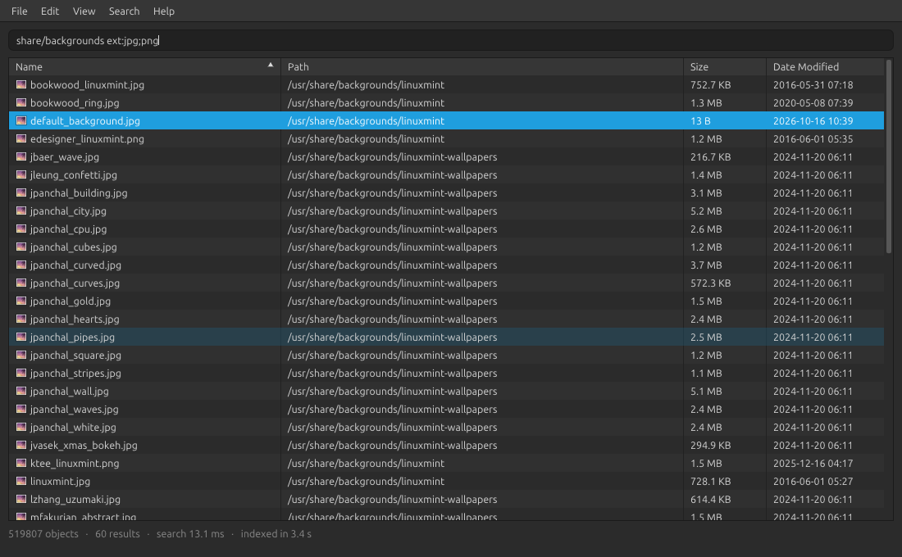
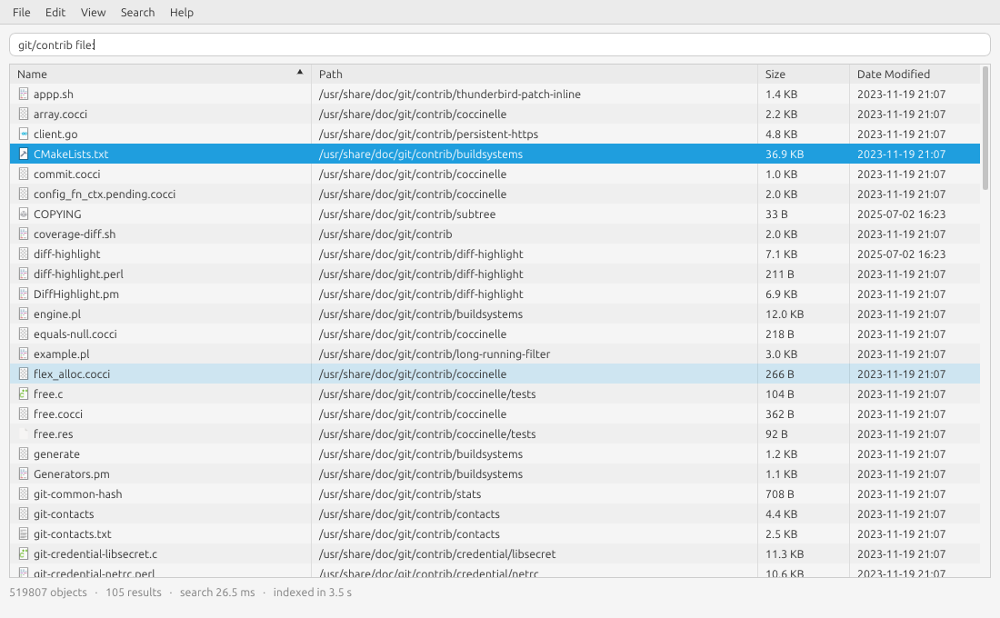
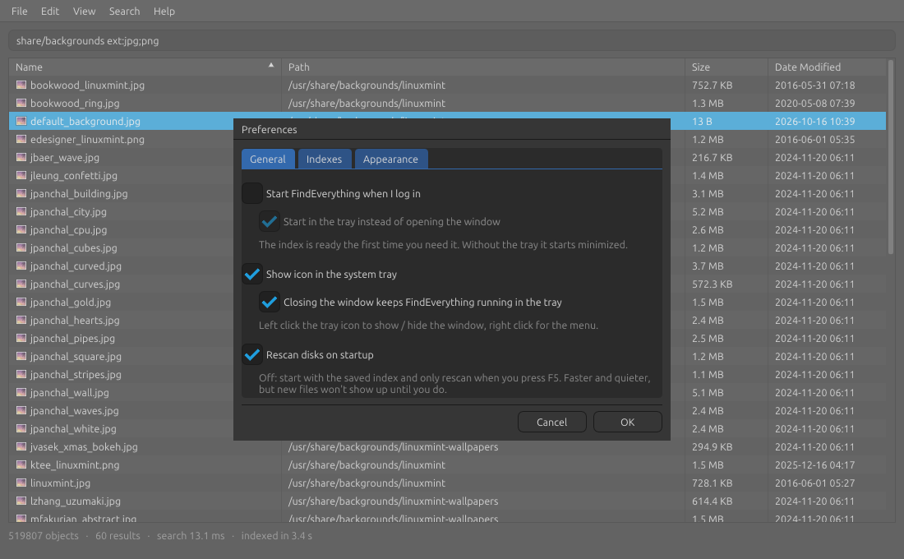

<p align="center">
  
</p>

<h1 align="center">FindEverything</h1>

<p align="center">
  <b>Every file on your Linux box, one keystroke away.</b><br>
  Type a few letters and half a million files narrow down to what you want while you're still typing.
</p>

<p align="center">
  <a href="https://github.com/KimsFerdy/FindEverything/releases/latest"></a>
  
  <a href="LICENSE"></a>
</p>

<p align="center">
  
</p>

---

Heavily inspired by [Everything](https://www.voidtools.com/) by voidtools, the thing I missed most after moving to Linux.
FindEverything indexes every file name on your disks once, keeps the whole index in RAM and searches it on every
keystroke. No daemon, no database, no waiting.

- **Fast.** ~500k files indexed in a few seconds, searched in ~10 ms, sorted in ~3 ms
- **Instant start.** The index is saved to disk and loaded in a fraction of a second, then refreshed in the background
- **Feels native.** Uses your system font, dark / light mode, accent color and icon theme
- **Stays out of the way.** Lives in the tray, can start with your session, closing the window keeps it running
- **Keyboard first.** Arrows, `Enter` to open, `Ctrl+Enter` to show in the file manager, `Ctrl+Shift+C` to copy the path
- **Small.** One ~1 MB binary, C++20 + Dear ImGui, no Qt or GTK

## Download

<p>
  <a href="https://github.com/KimsFerdy/FindEverything/releases/latest"><b>➜ Get the latest release</b></a>
</p>

| Package | Best for | Install |
|---|---|---|
| [`.deb`](https://github.com/KimsFerdy/FindEverything/releases/download/v0.1.0/findeverything_0.1.0_amd64.deb) | Ubuntu 24.04+, Linux Mint 22+, Debian 13+ | `sudo apt install ./findeverything_0.1.0_amd64.deb` |
| [`AppImage`](https://github.com/KimsFerdy/FindEverything/releases/download/v0.1.0/FindEverything-0.1.0-x86_64.AppImage) | Any recent distro, no install | `chmod +x FindEverything-*.AppImage && ./FindEverything-*.AppImage` |
| [`.tar.gz`](https://github.com/KimsFerdy/FindEverything/releases/download/v0.1.0/findeverything-0.1.0-linux-x86_64.tar.gz) | Manual install into `~/.local` | `tar xzf findeverything-*.tar.gz && cp -r findeverything-*/{bin,share} ~/.local/` |
| [Source](#build-from-source) | Everything else | see below |

Binaries are x86_64, built on Linux Mint 22 (glibc 2.39). Checksums are in `SHA256SUMS` on the release page.

## Screenshots

<p align="center">
  
</p>
<p align="center">
  
</p>

## Search syntax

| Query               | Matches                                |
|---------------------|----------------------------------------|
| `foo bar`           | name contains `foo` and `bar`          |
| `"foo bar"`         | exact phrase                           |
| `!tmp`              | name does not contain `tmp`            |
| `ext:jpg;png`       | jpg or png files                       |
| `file:` / `folder:` | only files / only folders              |
| `src/main`          | a `/` in a term searches full paths    |

Search menu: match case `Ctrl+I`, whole word `Ctrl+B`, match path `Ctrl+U`. `F1` shows this in the app.

## Keys

| Key                         |                          |
|-----------------------------|--------------------------|
| `↑` `↓` `PgUp` `PgDn`       | move through results     |
| `Enter`                     | open                     |
| `Ctrl+Enter`                | show in file manager     |
| `Ctrl+Shift+C`              | copy full path           |
| `F5`                        | rescan                   |
| `Ctrl+,`                    | preferences              |
| `Ctrl+=` `Ctrl+-` `Ctrl+0`  | zoom                     |
| `Ctrl+Q`                    | quit (closing the window only hides it to the tray) |

## Command line

```bash
FindEverything --search "ext:pdf invoice"   # open with a query
fe-cli ext:pdf invoice                      # print matches, uses the same saved index
fe-cli --root ~/Projects todo               # scan one folder only
```

## Build from source

```bash
git clone https://github.com/KimsFerdy/FindEverything.git
cd FindEverything
./scripts/install-deps-linux.sh                  # debian / ubuntu / mint
cmake --preset release && cmake --build --preset release
./build/release/FindEverything

cmake --install build/release --prefix ~/.local  # optional: app menu entry, no sudo
./scripts/package.sh                             # optional: .deb + AppImage + .tar.gz into dist/
```

The first configure downloads Dear ImGui, GLFW, stb and nanosvg. How it works inside:
[docs/ARCHITECTURE.md](docs/ARCHITECTURE.md). What's next: [docs/ROADMAP.md](docs/ROADMAP.md).

## Built with

- [C++20](https://en.cppreference.com/w/cpp/20) and [CMake](https://cmake.org)
- [Dear ImGui](https://github.com/ocornut/imgui) for the UI, [GLFW](https://www.glfw.org) + [OpenGL](https://www.opengl.org) for the window
- [stb_image](https://github.com/nothings/stb) and [nanosvg](https://github.com/memononen/nanosvg) for icons
- [sd-bus](https://www.freedesktop.org/software/systemd/man/latest/sd-bus.html) (systemd) for the tray icon
- freedesktop.org specs: [StatusNotifierItem](https://www.freedesktop.org/wiki/Specifications/StatusNotifierItem/),
  [shared-mime-info](https://specifications.freedesktop.org/shared-mime-info-spec/latest/),
  [Icon Theme](https://specifications.freedesktop.org/icon-theme-spec/latest/),
  [XDG Base Directory](https://specifications.freedesktop.org/basedir-spec/latest/),
  [Desktop Entry](https://specifications.freedesktop.org/desktop-entry-spec/latest/),
  [XDG Desktop Portal](https://flatpak.github.io/xdg-desktop-portal/)
- [linuxdeploy](https://github.com/linuxdeploy/linuxdeploy) for the AppImage

## Files it writes

- `~/.cache/findeverything/index.bin` — the saved index, safe to delete
- `~/.config/findeverything/settings.ini` — settings
- `~/.config/findeverything/imgui.ini` — column widths / sort
- `~/.config/autostart/findeverything.desktop` — only if "start at login" is on

## Status

0.1 is out, 0.2 (beta, on the `dev` branch) adds live updates: the index follows your disks while the app runs.
See the [changelog](CHANGELOG.md).

## License

MIT, see [LICENSE](LICENSE).

The app icon (`assets/findeverything.png`) is "Search" from the Qetto 2 icon set by
[Ampeross](https://www.deviantart.com/ampeross) and is not covered by the MIT license.
